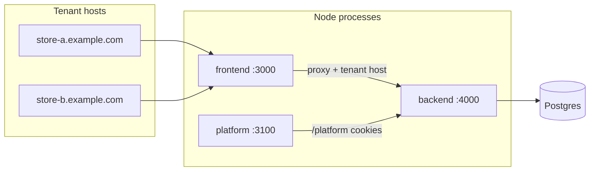
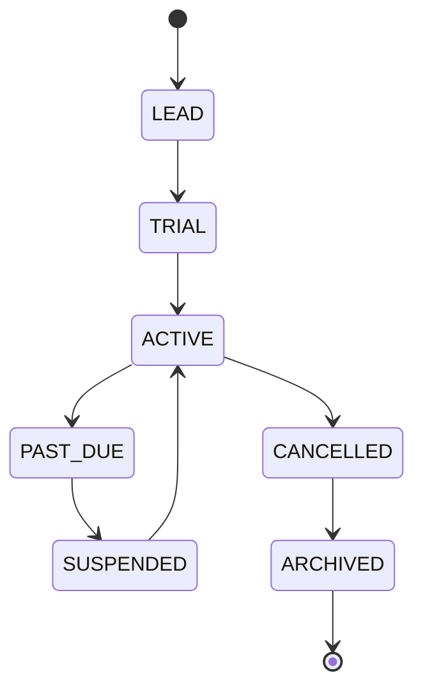

# Platform panel

Operator console for a shared-database Restaurant OS deployment. Tenants use the storefront and `/admin` app; platform staff use the **`platform/`** Next.js app (port 3100) and **`/platform/*`** APIs on the same backend.

## Architecture



- **Tenant resolution:** `Host` → `TenantDomain` / `Restaurant.hostname` / `Restaurant.slug` (see [MULTI_TENANCY.md](./MULTI_TENANCY.md)). Production never trusts a client-supplied tenant id in the body.
- **Staff auth:** tenant JWT + cookies (`rid` = restaurant id).
- **Platform auth:** separate `PlatformUser`, `PLATFORM_JWT_SECRET`, platform session cookies (`ros_platform_session` / `__Host-` in production).
- **Data:** one schema; `restaurantId` on tenant-owned rows; Prisma extension + RLS role `restaurant_app` for defense in depth.

## Role matrix

| Role | Tenants | Billing | Plans | Audit | Notes | Support sessions |
| --- | --- | --- | --- | --- | --- | --- |
| SUPER_ADMIN | read/write | read/write | read/write | read | write | write |
| ADMIN | read/write | read | read/write | read | write | write |
| BILLING | read | read/write | read | read | — | — |
| SUPPORT | read | — | read | read | write | write |
| READONLY | read | read | read | read | — | — |

Permissions are enforced in `backend/src/lib/platform/permissions.ts` and route middleware.

## Tenant lifecycle



| Status | Storefront | Staff login | Admin writes |
| --- | --- | --- | --- |
| TRIAL / ACTIVE | normal | yes | yes |
| PAST_DUE | normal | yes | yes (banner in tenant admin) |
| SUSPENDED | limited message | yes (read-only admin) | no (support JWT can bypass read-only) |
| CANCELLED | blocked | blocked | retention timer |
| ARCHIVED | 404 on host | blocked | data retained, not accessible |

Retention default: `TENANT_CANCEL_RETENTION_DAYS` (30). Hard purge is manual and not automated in the lifecycle job.

## Billing model

- **Manual only:** bank transfer, JazzCash, Easypaisa, cash, cheque — recorded in `PlatformPayment`. No card gateway.
- **Plans:** global `Plan` rows; each tenant has one `Subscription`.
- **Invoices:** `PlatformInvoice` per period; job `runPlatformBillingJob` opens invoices and can mark tenants past due.
- **Entitlements** (plan JSON → `loadTenantEntitlements`): `maxBranches`, `maxStaff`, `inventory`, `dineIn`, `pos`, `analytics`.

## Runbooks

### Onboard a new tenant

1. Platform → **Create tenant** (or `POST /platform/tenants`) with slug, display name, plan, trial, optional owner password.
2. Confirm DNS: `slug.ROOT_DOMAIN` CNAME or custom domain in **Domains** (API: `TenantDomain`).
3. Owner signs in on tenant host → **Settings** + **Plan and billing**.
4. Optional: `npm run tenant:export` after go-live for baseline backup.

### Suspend for non-payment

1. Ensure open `PlatformInvoice` and subscription `PAST_DUE` / tenant `PAST_DUE` or `SUSPENDED`.
2. Platform → tenant detail → set status **SUSPENDED** with a short reason (shown to staff, not on public storefront copy).
3. Storefront checkout and admin writes are blocked server-side; staff can still sign in read-only.

### Reactivate

1. Record payment on invoice (`POST /platform/invoices/:id/payments`).
2. Set tenant **ACTIVE** and subscription **ACTIVE** if needed.
3. Confirm storefront and POS behavior on tenant host.

### Support access

1. Platform → tenant → **Issue support token** (`POST /platform/tenants/:id/support-sessions`).
2. Open the **tenant domain** → exchange token (`POST /auth/support-exchange`) for a short-lived support JWT.
3. Revoke session on platform when done. Tenant owner can view history at `GET /admin/support-access/history`.

### Export tenant data

```bash
cd backend
TENANT_ID=<uuid> TENANT_EXPORT_FILE=/tmp/tenant-export.json npm run tenant:export
```

### Delete dry-run (before any purge)

```bash
TENANT_ID=<uuid> npm run tenant:delete-dry-run
```

Automated hard delete after archive is not enabled; use dry-run counts to plan a manual purge with FK-safe order.

### Rotate platform secrets

1. Set new `PLATFORM_JWT_SECRET` and `JWT_SECRET` (tenant) in the host env.
2. Restart API. All platform and tenant sessions invalidate.
3. Operators sign in again at `/platform` and tenants re-login.

### Recover locked platform admin

```bash
cd backend
PLATFORM_ADMIN_EMAIL=ops@example.com PLATFORM_ADMIN_PASSWORD='new-secure-pass' npm run platform:reset-access
```

Creates password and bumps `tokenVersion` (sign out everywhere). Platform users do not use TOTP yet.

### Restore one tenant from backup

1. Restore full `pg_dump` to a staging database **or** import logical export JSON into a rehearsal DB.
2. Verify `restaurantId` on restored rows with `npm run tenancy:backfill-verify`.
3. Cut over hostname / `TenantDomain` only after validation.

## CLI (backend)

| Command | Purpose |
| --- | --- |
| `npm run platform:create-admin` | Create/update `PlatformUser` (`PLATFORM_ADMIN_EMAIL`, `PLATFORM_ADMIN_PASSWORD`) |
| `npm run platform:reset-access` | Reset platform password + revoke sessions |
| `npm run tenant:export` | JSON export (`TENANT_ID`, optional `TENANT_EXPORT_FILE`) |
| `npm run tenant:delete-dry-run` | Row counts per table for a tenant |
| `npm run tenancy:check` | CI guard: models + `withoutTenant` allowlist |
| `npm run tenancy:backfill-verify` | Fail if any tenant table has null `restaurantId` |

## Local URLs

| App | URL |
| --- | --- |
| API | http://localhost:4000 |
| Tenant web | http://localhost:3000 |
| Platform panel | http://localhost:3100 |

Platform dev: `npm run dev:platform` (repo root). API must be running with platform seed user (`PLATFORM_SEED_EMAIL` in dev seed) or `platform:create-admin`.
