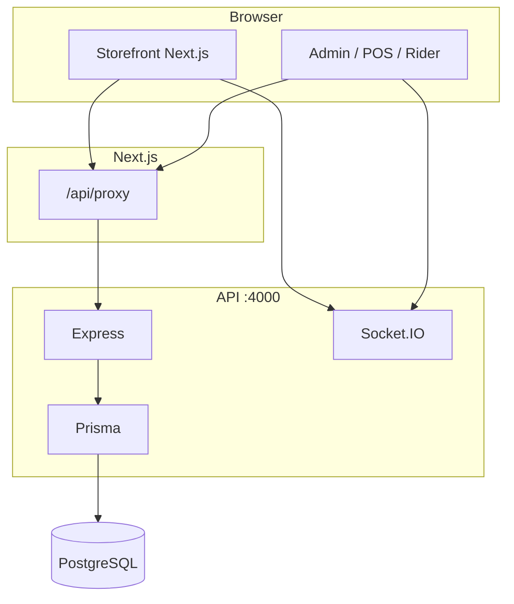
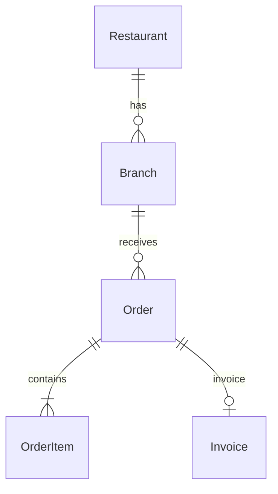

# Restaurant OS — Full technical audit (single document)

**Date:** 2026-10-17 · **Scope:** read-only code review; no application source modified.  
**Ground truth:** repository source; where `docs/RECON.md` disagrees, **code wins** (see § Docs vs code).

---

# Executive summary

## What the system is

A **single-tenant white-label restaurant platform**: customers order online (delivery/pickup), staff run **kitchen, POS, inventory, dine-in, and reports** from the admin UI, and **riders** update delivery status. One Node API (Express + Prisma + Postgres) and one Next.js 14 frontend use cookies/CSRF for auth and Socket.IO for live boards.

## Maturity by module (1 = sketch, 5 = production-ready)

| Module | Status | Score | Notes |
| --- | --- | --- | --- |
| Storefront (menu/cart/checkout) | IMPLEMENTED | 4 | No online payments |
| Order tracking / guest access | IMPLEMENTED | 4 | Phone + order # |
| Admin kitchen & tracking | IMPLEMENTED | 4 | Realtime + polls |
| POS & cash shifts | IMPLEMENTED | 4 | Offline sync Phase 3 |
| Inventory & recipes | IMPLEMENTED | 4 | Large surface area |
| Dine-in / bookings | IMPLEMENTED | 3 | Complex UI |
| Coupons & loyalty | PARTIAL | 3 | **Prod API gap R-001** |
| Reports & tax invoicing | IMPLEMENTED | 3 | Legal e-file MISSING |
| Storefront PWA / push / i18n | PARTIAL | 2 | EN/Urdu partial |
| Multi-restaurant SaaS | PARTIAL | 2 | One deploy = one restaurant |
| Test/CI confidence | PARTIAL | 3 | Backend CI; no frontend CI |

## Top 10 risks

1. **R-001 (Critical):** `index.ts` does not mount `/coupons`, `/admin/coupons`, `/admin/rider-cash`, `/admin/print-stations`, `/admin/kot` — but `app.ts` does.
2. **R-006 (High):** Production `start` runs `prisma/seed.ts` every boot.
3. **R-005 (High):** No automated frontend CI.
4. **R-004 (High):** Admin pages gated in client layout, not Next middleware.
5. **R-003 (High):** Dependency CVEs (sharp, source-map-js).
6. **R-002 (High):** DB integration tests fail without Postgres locally.
7. **R-010 (Medium):** Branch scoping may be incomplete on some admin queries.
8. **R-011 (Medium):** Duplicate `index.ts` / `app.ts` maintenance hazard.
9. **R-009 (Medium):** Outdated RECON doc.
10. **R-015 (Low):** Tax features are bookkeeping-oriented, not statutory compliance.

## Top 10 next steps

1. Fix **R-001** — align `index.ts` with `app.ts` (or use `createApp()` only).
2. Remove **seed from production start** (R-006).
3. Add **frontend CI** (typecheck + Playwright smoke).
4. Run **integration tests** on CI Postgres.
5. **Upgrade sharp** / audit dependencies.
6. **Update or archive RECON.md**.
7. Manual QA: `docs/PHASE3_CHECKLIST.md`.
8. **Branch-scope audit** for multi-outlet operators.
9. Payment gateway roadmap (out of scope today).
10. FBR / e-invoicing if required for Pakistan.

## How it fits together (plain language)

Customers browse the menu, check out with name/phone/address. Orders appear on the **kitchen screen**; managers assign **riders**. **Cashiers** use **POS** (including offline sync). **Inventory** can hide sold-out dishes. **Settings** control branding, hours, taxes. The website proxies API calls in production (`/api/proxy`).

## Glossary

| Term | Meaning |
| --- | --- |
| ORDER_OPS | Staff roles that can change orders (`lib/roles.ts`) |
| Guest token | JWT for tracking without account (`/orders/track`) |
| Branch scope | `X-Branch-Id` header for outlet filtering |
| KOT | Kitchen ticket routing by print station |
| COD | Cash on delivery / rider settlement |

## Open questions (owner)

1. Is production API definitely `index.ts` on Oracle/Render?
2. Should `seed` run on every production boot?
3. Must all reports be branch-isolated?
4. Payment gateway plans?
5. FBR compliance timeline?
6. Standard dev setup: Docker Postgres for all contributors?

---

# Docs vs code

| Document | Claim | Code truth |
| --- | --- | --- |
| `RECON.md` | No automated tests | Vitest: 92 tests (`backend/package.json`) |
| `RECON.md` | Stale workspace package names in docs | `restaurant-os-api` / `restaurant-os-web` |
| `RECON.md` | Hardcoded JWT demo secret | `lib/jwt-secret.ts` — env or ephemeral random |
| `RECON.md` | Roles omit MANAGER/WAITER | `Role` enum in `schema.prisma` |
| Earlier “33 pages” | 33 admin/store pages | **45** `page.tsx` files |
| `PHASE2.md` | Coupons E2E | **May 404 in prod** until R-001 fixed |

---

# Phase 0 — Repository overview

Restaurant OS is a **white-label operations monorepo**; one deployment ≈ one restaurant (`RESTAURANT_ID`, `resolveRestaurantId` in `backend/src/lib/prisma.ts`).

| Package | npm name | Role |
| --- | --- | --- |
| Root | `restaurant-os` | Workspaces |
| `backend/` | `restaurant-os-api` | Express + Socket.IO + Prisma |
| `frontend/` | `restaurant-os-web` | Next.js 14 App Router |

**Layout:** `backend/`, `frontend/`, `docs/`, `scripts/`, `docker-compose.yml`, `render.yaml`, `.github/workflows/`. No separate worker; dine-in jobs in-process (`startDineInJobScheduler` in `index.ts`).

**Versions:** Node 20 (CI), Next ^14.2.21, Express ^4.21.2, Prisma ^5.22.0, Vitest ^5.0.2, Playwright ^1.64.1.

**Root scripts:** `dev`, `db:up/down`, `prisma:migrate`, `seed:demo`, `test` (backend only), `typecheck`.

**Backend:** `dev` → `tsx watch src/index.ts`; `start` → migrate + **seed** + `index.ts`.

**Env (names only):** `DATABASE_URL`, `RESTAURANT_ID`, `JWT_SECRET`, `CLIENT_URL`, SMTP/WhatsApp/VAPID vars (`backend/.env.example`); frontend `NEXT_PUBLIC_API_URL`, `API_PROXY_TARGET`, `NEXT_PUBLIC_SOCKET_URL`. Local `.env` is gitignored.

**Ports:** API 4000, Next 3000, Socket.IO on same server at `/socket.io`.

**Critical:** Production uses `backend/src/index.ts`, **not** `createApp()` from `app.ts` — route drift (R-001).

---

# Phase 1 — History and evolution

| Metric | Value |
| --- | --- |
| Commits | 61 |
| Contributors | 1 (Abdul Rehman) |
| Active period | ~2026-09-16 – 2026-10-17 |

**Timeline (from commit messages):** init → categories/deals/areas → white-label tenant + order lifecycle (Sep 29) → branches/dine-in/security (Oct 10) → inventory/coupons/Phase 3 features (Oct 16–17).

**Demo vs platform:** Generic `StoreSettings` + `storefront-copy.ts`; demo menu/accounts in `prisma/seed.ts`; fixed Devsora “powered by” (`DECISIONS.md`).

**Churn leaders:** `admin/layout.tsx`, `types.ts`, `orders.ts`, `schema.prisma`, `seed.ts`.

**Migrations:** 40 folders; `prisma validate` PASS; `migrate status` UNVERIFIED (no DB during audit).

**npm audit (2026-10-17):** High — `sharp`, `source-map-js`. No Zod; custom validation.

---

# Phase 2 — Backend

## 2a Schema (Prisma)

- Money: `Decimal(10,2)`; `lib/money.ts`, tax rounding in `lib/tax/compute.ts`.
- No generic soft delete; flags like `isActive`, `isAvailable`.
- **~40 models:** Restaurant, Branch, User, StoreSettings, Order/OrderItem/OrderEvent, Invoice, Coupon, CashShift, inventory stack, dine-in, AuditLog, OrderFeedback, CustomerPushSubscription, etc.
- **Roles:** CUSTOMER, ADMIN, MANAGER, WAITER, RIDER, CHEF, CASHIER.
- **Order:** offline fields, tax snapshots, `checkoutIdempotencyKey`, `feedback`.

## 2b API surface

**Middleware order (`index.ts`):** trust proxy → restaurant context → security headers → CORS → JSON → CSRF → rate limit → `/uploads`.

**Production mounts (`index.ts` L82–104):** health, upload, auth, menu, categories, deals, delivery-areas, settings, branches, dine-in, admin/dine-in, admin/inventory, orders, pos (+ `/pos/shift`), rider, admin/staff, blocks, audit-logs, approval, shifts, reports, admin, invoices.

**Missing from `index.ts` but present in `app.ts` (R-001):**

| Prefix |
| --- |
| `/coupons` |
| `/admin/coupons` |
| `/admin/rider-cash` |
| `/admin/print-stations` |
| `/admin/kot` |

**`/orders` highlights:** POST checkout, GET mine/active, POST track, push/feedback, GET/PATCH by id, status, line delete, rider assign.

**`/admin/reports`:** dish-costing, menu-engineering, variance, sales-intelligence, daily-summary, tax-* (+ CSV).

Branch scoping: **PARTIAL** (`lib/branch-scope.ts`).

## 2c Business logic

- **Order machine:** `lib/order-machine.ts`; client mirror in `frontend/src/lib/types.ts`.
- **Create:** storefront `POST /orders`, POS `POST /pos`, offline `POST /pos/sync`.
- **Pricing:** `order-lines` → `charges` → optional `tax/apply`.
- **Status PATCH:** events, audit, email, inventory, COD, loyalty, invoice, credit note, push.
- **Inventory:** recipes, deduct timing, auto-hide, purchases/waste/counts/transfers, weighted avg cost.
- **Dine-in:** public booking + large `dine-in.ts` admin API + scheduler jobs.
- **Notifications:** email/WhatsApp/push — fire-and-forget, no queue.
- **Realtime:** Socket.IO + `emitOrderChange`.

## 2d Security

- bcrypt + JWT (HttpOnly cookie); 2FA for ADMIN/MANAGER; `tokenVersion`; guest order tokens.
- CSRF on mutating requests; rate limiters; CORS from `CLIENT_URL`.
- No PCI path (no payment gateway).
- Staff ORDER_OPS can access orders by id by design.
- `.env` gitignored; examples are placeholders only.

---

# Phase 3 — Frontend

- Next.js 14 App Router; **no** `middleware.ts` — guards in `admin/layout.tsx`, `RoleRedirect`.
- **45** `page.tsx` routes (not 33): storefront, checkout, track, book/wait, full admin module set, rider.
- Largest UIs: `settings/page.tsx` (~1442 LOC), `pos/page.tsx` (~1174), `InventoryModule.tsx`.
- Theme: `brand-theme.ts` + Tailwind `brand-*`; admin dark in `globals.css`.
- PWA: `store-sw.js`, `manifest.ts`; POS: separate `pos-sw.js`.
- i18n: partial EN/Urdu (`lib/i18n/storefront.tsx`).
- `images.unoptimized: true` — performance risk.
- No sitemap/JSON-LD found.

---

# Phase 4 — Runtime verification

| Command | Result |
| --- | --- |
| `prisma validate` | PASS |
| `prisma migrate status` | FAIL (no Postgres) |
| `npm test` | 84 pass, 8 fail (DB integration tests) |
| `next build` | FAIL (sandbox EACCES) |
| Docker | Not available |
| Playwright | NOT RUN |
| Manual E2E flows | NOT RUN |

Failed tests (likely need DB): audit-log, approval-pin-lockout, inventory-availability, inventory-stock-concurrency, pos-offline-sync.integration, pos-order-number.

---

# Phase 5 — Risks and gaps

## Testing & ops

- Backend: 26 test files; no frontend unit tests; Playwright behind `E2E_RUN`.
- Health: `/health`; migrations on deploy; no APM; no graceful SIGTERM in `index.ts`.
- ESLint: not configured repo-wide.

## Product gaps

| Need | Status |
| --- | --- |
| Day-to-day ops (POS/kitchen/inventory) | IMPLEMENTED |
| Fraud (PIN, audit, shifts) | IMPLEMENTED |
| FBR e-invoicing | MISSING |
| Online payments | MISSING (by design) |
| True multi-tenant SaaS | PARTIAL |

## Risk register

| ID | Title | Severity | Suggested fix | Effort |
| --- | --- | --- | --- | --- |
| R-001 | `index.ts` missing coupon/rider-cash/KOT/print routes | Critical | Mount same routers as `app.ts` or use `createApp()` only | S |
| R-002 | Integration tests need Postgres | High | Document DB for tests; CI Postgres | S |
| R-003 | npm audit: sharp, source-map-js | High | Upgrade/fix | M |
| R-004 | Admin auth client-only | High | Next middleware or SSR guard | M |
| R-005 | No frontend CI | High | Add workflow | L |
| R-006 | `start` runs seed every boot | High | Remove seed from start | M |
| R-007 | Silent notification failures | Medium | Queue/logging | S |
| R-008 | Unoptimized images | Medium | Enable Next images/CDN | M |
| R-009 | Stale RECON.md | Medium | Update docs | S |
| R-010 | Branch filter gaps | Medium | Audit admin queries | M |
| R-011 | index.ts vs app.ts drift | Medium | Single entry | M |
| R-012 | No graceful shutdown | Medium | SIGTERM handler | S |
| R-013 | Guest token in sessionStorage | Low | Document / cookie | M |
| R-014 | Push off by default | Low | VAPID + settings | S |
| R-015 | Tax not legally certified | Low | External integration | L |

---

# Commands run (audit)

`git log`, `prisma validate`, `prisma migrate status` (fail P1001), `npm test` (84/92), `npm audit`, `find page.tsx` (45), `rg TODO` (none), `git check-ignore backend/.env`, frontend `build` (fail EACCES), docker (unavailable).

---

# Key source index

| Topic | Path |
| --- | --- |
| API entry (prod) | `backend/src/index.ts` |
| API entry (tests) | `backend/src/app.ts` |
| Schema | `backend/prisma/schema.prisma` |
| Orders | `backend/src/routes/orders.ts` |
| POS | `backend/src/routes/pos.ts` |
| Order state machine | `backend/src/lib/order-machine.ts` |
| Auth | `backend/src/middleware/auth.ts`, `lib/jwt-secret.ts` |
| Frontend API client | `frontend/src/lib/api.ts` |
| Admin guards | `frontend/src/app/admin/layout.tsx` |
| Phase 3 QA checklist | `docs/PHASE3_CHECKLIST.md` |
| Tax compliance notes | `docs/TAX_INVOICING_NOTES.md` |

*End of audit document.*
